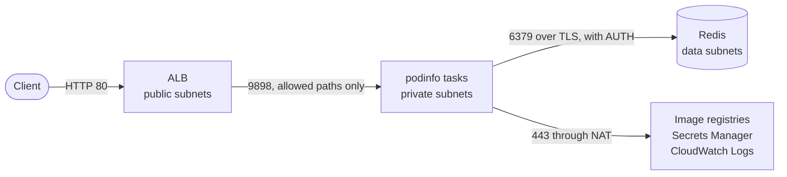

# ecs-fargate-terragrunt

A containerized web app ([podinfo](https://github.com/stefanprodan/podinfo)) on ECS Fargate, for two
environments (dev and prod), managed with Terragrunt.

The app sits behind an Application Load Balancer, reads one secret from Secrets Manager, and proves at
startup that it can reach and log in to an ElastiCache Redis replication group. It scales on request rate.

Both environments can be planned with nothing applied. Both were also applied in a real AWS account, to
check what a plan cannot show, and destroyed again. The section
[What has been verified](#what-has-been-verified) says exactly what was checked and how.



## What is provided

```
live/
  root.hcl                # state backend, provider, tool version constraints
  dev/   env.hcl  network/  redis/  secret/  platform/  service/
  prod/  env.hcl  network/  redis/  secret/  platform/  service/
modules/
  redis/                  # replication group, its AUTH token, subnet group, security groups
  secret/                 # one Secrets Manager secret with a generated value
  platform/               # ECS cluster and the shared load balancer
  ecs-service/            # the reusable service module
```

Each environment has five units. Each unit has its own state file.

| Unit | Depends on | Creates | Resources (dev / prod) |
|---|---|---|---|
| `network` | nothing | VPC with public, private and data subnets, NAT, routes. Uses the public [`terraform-aws-modules/vpc`](https://registry.terraform.io/modules/terraform-aws-modules/vpc/aws) module, pinned to 6.7.3. | 30 / 38 |
| `secret` | nothing | The secret podinfo signs its tokens with. | 2 / 2 |
| `redis` | `network` | Redis replication group, its AUTH token in a secret of its own, the two security groups that control access to it, and its engine and slow logs. | 11 / 11 |
| `platform` | `network` | What every service shares: the ECS cluster and the load balancer with its listener, and the logs of both. | 19 / 19 |
| `service` | all four | Everything that belongs to one service: target group, listener rule, task definition, ECS service, IAM roles, security group, log group, autoscaling. | 15 / 15 |

## How to plan it

You need Terraform 1.11 or newer, Terragrunt 1.0 or newer, and AWS credentials for any account.
It was written and tested with Terraform 1.15.2, Terragrunt 1.1.2 and AWS provider 6.68.0. The repo is
pinned to Terraform, so that is what runs even where OpenTofu is installed.

If you only have OpenTofu, set `TG_TF_PATH=tofu` in your shell, which overrides the pin. OpenTofu 1.13.1
plans both environments with the same result. It rewrites the `.terraform.lock.hcl` files to name its
own registry, at the same provider versions. Nothing has been applied with OpenTofu.

The region is `us-east-1`, and the three zones are chosen by zone ID. Both are set in
[`live/root.hcl`](live/root.hcl).

**1. Choose a state bucket.** A plan has to read the state, even an empty one, so it needs an S3 bucket
before it can start. There are two ways to give it one. Pick either:

- **Option A:** let Terragrunt create a new bucket for this repo.
- **Option B:** use a bucket you already have.

**Option A: a new bucket.** Run this once:

```
terragrunt --non-interactive --working-dir live/dev/network backend bootstrap
```

It creates `tfstate-<your account id>-<region>` with versioning, encryption, public access blocked and a
TLS-only bucket policy. The region is `us-east-1` unless you change it, and the account ID is looked up
from your credentials, so there is nothing to edit. It is the only thing this repo creates in your
account.

**Option B: your own bucket.** Name it in your shell, in every shell you run Terragrunt from:

```
export STATE_BUCKET=<your bucket>
export STATE_BUCKET_REGION=<its region>   # only if it is not us-east-1
```

Every state key starts with `ecs-fargate/`, so nothing else in that bucket is touched.

Without one of the two, every unit fails at `init` with `S3 bucket "..." does not exist`: Terragrunt 1.x
does not create a bucket by itself.

**2. Plan an environment.**

```
terragrunt --working-dir live/dev run --all -- plan
terragrunt --working-dir live/prod run --all -- plan
```

Each run should end with `Run Summary  5 units ... Succeeded 5`, adding 77 resources in dev and 85 in prod.
A single unit can be planned on its own, for example `terragrunt --working-dir live/dev/redis plan`.

Two things to know when reading the output:

- **Placeholder values are expected.** With nothing applied, a unit cannot read real outputs from the
  units it depends on. Each `dependency` block therefore has `mock_outputs`, which Terragrunt uses for
  `init`, `validate` and `plan` only. You will see six warnings saying so, and values such as
  `vpc-00000000000000000`, `mock-redis.invalid` and mock secret ARNs in the `redis`, `platform` and
  `service` plans. An `apply` does not accept mocks; it fails until the unit it depends on exists.
- **`--provider-cache` saves time.** Added after `run --all`, it downloads each provider once instead of
  once per unit.

To remove the bucket from option A afterwards, empty it and delete it in the S3 console. It is versioned,
so `aws s3 rb --force` alone may not be enough.

## If you apply it

A few things are worth knowing before you apply. I found them by applying and destroying both
environments.

```
terragrunt --working-dir live/dev run --all -- apply
terragrunt --working-dir live/dev run --all -- destroy
```

- **Order and time.** Terragrunt applies the units in dependency order and destroys them in reverse.
  Over several runs, applying took 11 to 13 minutes for dev and 15 to 25 for prod, most of it Redis.
  Destroying took 12 to 18 and 15 to 29.
- **An apply that fails part way can be run again.** It carries on from what already exists.
- **Dev's load balancer admits nobody until you say who.** The committed source range is a placeholder.
  To let one address in without editing a file, set this in your shell. Only one unit reads it,
  `live/dev/platform`:

  ```
  export DEV_INGRESS_CIDR=198.51.100.7/32
  ```

- **Prod resists deletion, on purpose.** A destroy fails on the load balancer until its deletion
  protection is turned off, in the code or with the AWS CLI. I used the CLI:

  ```
  aws elbv2 modify-load-balancer-attributes --load-balancer-arn <arn> \
    --attributes Key=deletion_protection.enabled,Value=false
  ```

- **A prod destroy leaves three things behind:**
  - both secrets, scheduled for deletion in 30 days, with their names taken until then.
    `aws secretsmanager delete-secret --secret-id <name> --force-delete-without-recovery` removes one;
  - the final snapshot Redis takes when it is deleted, `ecs-fargate-prod-redis-final`;
  - a log group that Container Insights creates by itself,
    `/aws/ecs/containerinsights/ecs-fargate-prod/performance`.

What the two environments cost while they run is under [Dev versus prod](#dev-versus-prod).

## Design decisions

**One state per unit.** The network, Redis, the secret, the shared platform and the service change at
different rates and have different owners. A service deploy cannot touch the VPC or Redis, and plans stay
small. The cost is the mock outputs described above.

**Dev and prod are plain copies with different inputs.** There is no shared include layer between them,
so `diff -r -x .terragrunt-cache live/dev live/prod` shows exactly how the environments differ.

**A public module for the VPC, hand-written modules for the rest.** The VPC is a commodity and not what
this repo is about. Redis, the secret and the service are small, and they are the parts worth
justifying, so every resource in them is one I chose.

**`platform` is separate from `ecs-service`.** The cluster and load balancer are shared by every service
in an environment. Adding a second service is one more unit that uses `ecs-service` with its own name,
image, paths and listener rule priority. It does not need a second load balancer, and it does not have
to use Redis: the module's `redis` input is optional. Its image has to be a public one for now; see
[Trade-offs](#trade-offs).

**`ecs-service` takes its surroundings as inputs.** It creates no VPC, cluster, load balancer or secret.
It receives their IDs and ARNs, which is what makes it reusable.

**Zones are chosen by ID.** A name such as `us-east-1a` is an alias AWS assigns per account, so it can
be a different physical zone for each reader. The three zone IDs in `root.hcl` are the same zones for
everyone. `use1-az3` is left out as a precaution: AWS's
[list of Fargate regions](https://docs.aws.amazon.com/AmazonECS/latest/developerguide/AWS_Fargate-Regions.html)
excludes it for Windows containers. It lists no such limit for Linux containers, which is what this
repo runs, so any three zones of `us-east-1` would do.

**State backend.** S3: by default one bucket per account and region, or a bucket you name. There is
one key per unit, and every key starts with `ecs-fargate/`, so the state can share a bucket with other
projects. Locking uses S3 itself (`use_lockfile`), so there is no DynamoDB table.

**Lock files are committed.** Each unit's `.terraform.lock.hcl` pins the provider versions, so you plan
with the same versions I did. They hold hashes for macOS and Linux, on both Intel and ARM.

## Why the task can reach Redis

1. **Network path.** The tasks are in the private subnets and the Redis nodes are in the data subnets of
   the same VPC. Traffic between them uses the VPC's local route and never leaves it. The data subnets
   have no other route, so Redis cannot reach the internet or be reached from it.
2. **Security groups.** The group on the Redis nodes accepts port 6379 from one source only: a
   `redis-client` security group. The service attaches that client group to its tasks, and the client
   group carries the matching outbound rule. Being a member of the client group is the permission.
   Both groups live in the `redis` unit, so the service never edits another unit's security group.
3. **Name resolution.** The task is given the replication group's primary endpoint. That name always
   resolves to the current primary, including after a failover.
4. **Encryption.** In transit (TLS) and at rest, in both environments.
5. **Authentication.** Redis requires an AUTH token. The `redis` unit generates it and keeps it in a
   Secrets Manager secret of its own.
6. **Proof at startup.** The task definition has a `redis-check` container. It receives the token, runs
   `redis-cli --tls -h <endpoint> -p 6379 ping`, and succeeds only if the reply is `PONG`. It compares
   the reply because `redis-cli` exits 0 even when Redis refuses the token. The application container
   depends on it with condition `SUCCESS`, so podinfo only starts if Redis was reached and accepted the
   token. If not, the task fails, and the deployment circuit breaker rolls the service back.

The connection is made by `redis-check` and not by podinfo, because podinfo's built-in Redis client does
not support TLS.

A task can otherwise only receive traffic from the load balancer on port 9898 and send HTTPS (image
pulls, Secrets Manager, CloudWatch Logs).

**Where to see this in a plan**

- In the `redis` unit: `aws_vpc_security_group_ingress_rule.redis_from_client` and
  `aws_vpc_security_group_egress_rule.client_to_redis`, the two rules that tie the groups together.
- In the `service` unit, inside `aws_ecs_task_definition.this`: the `redis-check` container with its
  command and its `REDISCLI_AUTH` secret, and the `dependsOn` entry of the `app` container with
  condition `SUCCESS`.
- One thing a first plan cannot show: the two security groups on the tasks. The plan prints that list as
  `(known after apply)`, because the service's own group does not exist yet. It is set in
  `network_configuration` in [`modules/ecs-service/main.tf`](modules/ecs-service/main.tf).

## Secrets

The application reads one secret. The setup holds a second one, the Redis AUTH token, which the
application never sees: only the startup check reads it.

**The application's secret** is the key podinfo signs its JWTs with. podinfo reads it from
`PODINFO_JWT_SECRET`; without it, it falls back to a default that is hardcoded in its public source.
`POST /token` shows the key is in use. It is the one secret the application reads, and it has its own
unit so that it outlives the service.

**The Redis AUTH token** is read only by the `redis-check` container, as `REDISCLI_AUTH`. podinfo never
sees it. It is created in the `redis` unit, because it has to be given to the secret and to ElastiCache
in the same run.

What both have in common:

- **The value is never in the plan or the state.** It is generated as an ephemeral `random_password` and
  written through a write-only argument. Raising a version number generates a new one.
- **Secrets Manager holds the only copy of the Redis token.** ElastiCache is given the value read back
  from the secret, not the generated one, so a re-run after a failed apply still uses the stored token.
- **The task definition holds ARNs, not values.** ECS fetches the values when a task starts, so running
  tasks need a new deployment to pick up a new value.
- **Least privilege.** The task execution role can read exactly these two secrets and write to the
  service's own log group. The task role, which the application runs as, has no permissions.

## How it is exposed

The load balancer is the only public entry point. Its listener answers 404 by default, and each service
adds a rule that forwards only the paths it owns. For podinfo those are `/`, `/version`, `/api/*` and
`/token*`.

This matters because podinfo is a demo app: `GET /env` prints its environment, which includes its
signing key, and `GET /panic` kills the process. Neither path is forwarded.

Dev is not open to the internet. Its load balancer admits only the ranges in `ingress_cidrs`. The
committed value, `203.0.113.0/24`, is a reserved documentation range, so dev stays closed until it is
replaced with a real VPN or office range.

The listener is HTTP only. HTTPS needs a certificate for a domain, which a blank account does not have.

## Autoscaling

podinfo is a stateless HTTP API. Its handlers are cheap, so a task serves many requests before its CPU
is busy. The service uses two target tracking policies:

- **Requests per task per minute** (`ALBRequestCountPerTarget`) is the main signal. It measures the load
  directly, and it rises as soon as traffic does, before the tasks are short of CPU.
- **Average CPU at 60%** is the backstop. CPU is what a task finally runs out of, and this policy catches
  what the request count cannot see, such as requests that become more expensive.

AWS adds tasks when either policy asks for more and removes them only when both agree. After a change it
waits 60 seconds before adding more tasks and 300 seconds before removing any, so a short dip does not
cause flapping.

There is no memory policy. podinfo's memory hardly moves with the load: in the load test a task used
under 5% of its memory at three and a half times the request target, so a memory policy would have
nothing to act on.

The request targets are placeholders, and dev's is set low so that scaling can be shown with a small
load generator. A load test in dev showed the policy scaling out and back in. In it, one task at three
and a half times dev's target used about 4% of its CPU. No test has measured how much one task can
serve. The method would be to find the rate at which one task's latency starts to degrade and set the
target at about two thirds of it.

## Logs

Everything is in CloudWatch Logs, kept 7 days in dev and 90 in prod.

| Log | What it answers |
|---|---|
| Container logs | What the application and the Redis check printed |
| Load balancer access logs | Who requested what, and with what result. It is the only record of requests the listener rejects, such as `/env`, because those never reach a task |
| ECS events | Why a task stopped. ECS itself only shows this for about an hour |
| ECS action logs | What ECS did on the account's behalf, such as each step of a deployment |
| Redis engine log and slow log | Restarts, failovers and slow commands |

The load balancer and ECS logs are delivered through the CloudWatch Logs integration. Switching logs on
as a load balancer attribute, with an S3 bucket, is the older way that AWS now labels "legacy".

## Hardening and operations

- **Containers:** both have a read-only root filesystem and all Linux capabilities dropped. The Redis
  check runs as the `redis` user, and podinfo's image runs as a non-root user of its own.
- **Logging cannot stall the app:** log delivery is non-blocking, with a buffer.
- **`apply` waits for the tasks:** it succeeds only when the new tasks are running and healthy, so a
  pipeline sees a failed Redis check as a failed deploy.
- **Zone rebalancing:** ECS evens tasks out across zones again after a zone problem or a scale-in.
- **Tags reach the tasks:** tasks inherit the service's tags, so their cost can be attributed.
- **Redis in prod:** the daily snapshot and the weekly maintenance have explicit, non-overlapping times.

## Dev versus prod

Both environments have the same shape: three zones, each with a public, a private and a data subnet.
Subnets cost nothing, so dev exercises the same layout as prod. What dev lacks is the redundancy.

| | dev | prod |
|---|---|---|
| VPC range | `10.0.0.0/16` | `10.1.0.0/16` |
| NAT gateways | 1, shared | 3, one per zone |
| Redis | 1 × `cache.t4g.micro`, no failover | primary + replica on `cache.m7g.large`, automatic failover, Multi-AZ |
| Redis backups | none | 7 daily snapshots, final snapshot on deletion |
| Redis changes | applied immediately | held for the maintenance window |
| Redis snapshot and maintenance times | chosen by AWS | 01:00 to 02:00 UTC daily, Sundays 03:00 to 04:00 UTC |
| Recovery window, both secrets | 0 days | 30 days |
| Load balancer | source allow-list, no deletion protection | open to the internet, deletion protection |
| Container Insights | off | on |
| Fargate capacity, for the service and as the cluster default | Spot | on-demand |
| Task size | 0.25 vCPU / 512 MiB | 0.5 vCPU / 1 GiB |
| Tasks, min to max | 1 to 3 | 3 to 12 |
| Requests per task per minute | 600 | 3000 |
| Retention of every log | 7 days | 90 days |

Prod never runs fewer than three tasks, one per zone, so losing a zone leaves two.

**What losing a zone does**

- **In prod,** two of the three tasks keep serving, and the NAT gateways of the other two zones keep
  working. If the Redis primary was in that zone, the replica takes over; in a test that took 20 seconds.
- **In dev,** it depends on the zone. The one NAT gateway and the one Redis node each sit in a single
  zone. If that zone is lost, outbound access or Redis goes with it, and no new task can start.

**What they cost**

Roughly $80 a month for dev and $430 for prod while they run, by my estimate from list prices, with no
traffic. About three quarters of prod's cost is its two Redis nodes and three NAT gateways, which is the
price of the redundancy above.

## Trade-offs

The ones that matter most come first.

- **One AWS account for both environments.** Everything here runs in a single account, so dev and
  prod are separated by name prefix and by VPC. In practice each environment would have its own account.
  The bucket name already includes the account ID, and the two VPC ranges do not overlap.
- **HTTP only, and a public load balancer.** See [How it is exposed](#how-it-is-exposed) and the target
  design under [What I would add later](#what-i-would-add-later).
- **The Redis check blocks startup.** That is its purpose here, but it also means new tasks cannot start
  during a Redis outage, so scale-out is blocked while running tasks carry on. For a cache in production
  I would let the application connect lazily and degrade.
- **A Redis token, not IAM authentication.** IAM authentication stores no credential, which is better.
  But the client has to sign its own short-lived tokens, and `redis-cli` cannot, so the check would need
  a purpose-built image.
- **Token rotation is only half automated.** Raising the token's version writes a new one to the secret
  and to Redis, and ElastiCache keeps accepting the old one so running tasks are not cut off. Redeploying
  the tasks and retiring the old token are still manual.
- **Planning the `redis` unit reads the token.** Once the secret exists, each plan reads it into memory
  to hand to ElastiCache. It is not stored, but whoever plans needs permission to read that secret.
- **Modules are local paths.** Both environments always use the same module code. Modules in their own
  repository, referenced by version tag, would let prod stay on a version while dev tries the next.
- **Images are public and pinned by tag.** podinfo `6.15.0` comes from GitHub's registry and
  `redis:7.4-alpine` from ECR Public. A tag can be moved; a digest cannot. Every task start pulls both,
  so starting a task depends on those two registries and on a NAT gateway.
- **`ecs-service` cannot pull from a private registry.** Its execution role may write logs and read the
  task's secrets, and nothing else. A service whose image is in private ECR would need the pull
  permissions added to that role, and the module has no input for them and no output for the role.
- **NAT gateways for outbound access.** Simple, but a fixed cost per gateway, and prod has three.
- **`engine = "redis"`.** Valkey is the cheaper drop-in AWS now recommends.
- **Logs go to CloudWatch, which charges per gigabyte delivered.** That is negligible here. At high
  traffic the same load balancer delivery can point at S3 instead.
- **Two CloudWatch Logs resource policies per environment.** An account may have ten per region, so
  many environments in one account would need a single shared policy.
- **The state bucket is created by Terragrunt's bootstrap,** not managed as code. S3 is the only
  backend: there is no local-state mode, so the path you plan with is the one that would be used.

## What I would add later

**What I would do first**

1. **HTTPS and an edge in front.** A domain and certificate, then CloudFront and WAF with the load
   balancer made internal. Today traffic is plain HTTP and prod's load balancer faces the internet.
2. **An account per environment, and a pipeline.** Today both environments share an account, and every
   apply runs from a laptop with admin rights.
3. **Alarms, and a load test.** Today nothing tells anyone when the service is failing, and the scaling
   targets are guesses.

The rest, by area. The first three appear again in their groups, with the detail.

**Exposure and access**
- Production behind CloudFront and WAF, with the load balancer made internal and attached as a VPC
  origin, so nothing can bypass the edge. TLS terminates at CloudFront. The path allow-list moves to WAF.
- Dev reachable only over a VPN such as Tailscale, with an internal load balancer.
- A domain, certificate and DNS records.
- Encryption in transit on every hop: HTTPS from CloudFront to the load balancer, and from the load
  balancer to the tasks. Today the hop to the tasks is plain HTTP inside the VPC.

**Accounts and delivery**
- One account per environment under an AWS organization, with an account level in the directory layout
  and `allowed_account_ids` on the provider.
- CI that plans on pull requests and applies on merge, assuming a role per account, with separate
  read-only plan and apply roles.
- `tflint`, a policy scanner and `terraform test` in that pipeline.
- Modules in their own repository, versioned by tag.

**Security**
- IAM authentication for Redis with named users in a user group, which removes the stored token.
- A network ACL on the data subnets as a second layer behind the security groups.
- Customer-managed KMS keys for the secrets, Redis, logs and state.
- Scheduled rotation of both secrets, with a forced deployment so tasks pick up the new values.
- Images mirrored to private ECR and pinned by digest.
- VPC endpoints for AWS APIs, so that traffic does not go through NAT.
- VPC flow logs.

**Operations and cost**
- Alarms and a dashboard: 5xx rate, target response time, unhealthy targets, Redis memory and evictions.
- A load test to calibrate the scaling targets.
- ECS Exec for debugging in dev, with its own audit logging.
- Deployments that roll back when an error-rate alarm fires, and blue/green deployments.
- A mix of on-demand and Spot capacity in prod: on-demand for the minimum, Spot for scale-out.
- Least-outstanding-requests routing on the target group, and a tracing sidecar.
- Service Connect, once there is a second service to call.
- The enhanced level of Container Insights in prod.
- ARM64 tasks, which are cheaper on Fargate; both images support it.
- Scheduled scaling to zero for dev outside working hours.
- The state bucket managed as code, with a lifecycle rule for old object versions.

## What has been verified

Everything below was run on 11 October 2026 against the code as it is here. Only comments and this
README have changed since. The one exception carries its own date.

**By planning, from a clean copy with nothing applied**

- **Both environments plan.** The committed files were copied to an empty directory and
  `terragrunt run --all -- plan` was run for each environment in a real AWS account. Both succeeded: 5
  units each, 77 resources in dev and 85 in prod.
- **The same with OpenTofu.** With `TG_TF_PATH=tofu`, OpenTofu 1.13.1 planned both environments from
  the same copy: 77 and 85 again, with the same provider versions.
- **Formatting and validation.** `terraform fmt`, `terragrunt hcl fmt` and `terraform validate` pass for
  every module. `terraform test` covers `ecs-service` with and without Redis, against a mocked provider.
  It needs no credentials and creates nothing. To run it, from the root of the repo:

  ```
  cd modules/ecs-service
  cp ../../live/dev/service/.terraform.lock.hcl .   # the same provider version the units use
  terraform init -backend=false
  terraform test
  ```

- **The state bucket bootstrap.** It was run on 9 October, and the bucket's versioning, encryption,
  public access block and policy were read back.

**By applying both environments in a real AWS account**

- **All ten units applied,** 77 resources in dev and 85 in prod, each unit using the real outputs of the
  ones before it. A second plan reported no changes in any of them.
- **The zones.** In both environments the nine subnets are in `use1-az1`, `use1-az2` and `use1-az4`,
  three in each.
- **The startup check.** Every task logged `Redis replied: PONG` and only then started podinfo. That one
  line covers the network path, the security groups, TLS, the AUTH token and the secret injection.
- **A failing check, three ways.** In dev, one value of the service's `redis` input was set wrong on
  purpose, with the other three right:
  - *The port.* The check got no reply and gave up after its ten seconds.
  - *The token.* Redis answered at once with `WRONGPASS`: it was reached, and it refused the login.
  - *The security group,* with the tasks left out of the client group. No reply again. The port and the
    token were right this time, so it was the security groups that stopped it.

  Each time podinfo never started in any task, the circuit breaker rolled the service back after three
  or four failed tasks, eight to ten minutes in, the old task kept serving, and `apply` ended with an
  error.
- **A service without Redis.** The dev service was applied once with `redis = null`. It ran with one
  container and one security group, and without the Redis token in its execution role's policy. A
  second plan reported no changes. It was then put back.
- **Prod's own settings,** read back from AWS:
  - Redis has a primary and a replica in different zones, with automatic failover and Multi-AZ on, and
    the snapshot and maintenance times as set.
  - There is a NAT gateway per zone, and each private route table uses the gateway of its own zone.
  - Three on-demand tasks run, one in each zone.
  - Deletion protection is on, and every log group keeps 90 days.
- **A Redis failover in prod.** ElastiCache's own failover test moved the primary to the replica in 20
  seconds. Three new tasks then passed their startup check through the same endpoint name, and a plan
  afterwards reported no changes. The check sends `PING`, which a replica answers too, so this shows the
  endpoint leads to a node that accepts the connection and the token.
- **Autoscaling, in dev.** Under about 2,060 requests a minute, against a target of 600 per task, the
  service went from 1 task to 3, one in each zone, and was back at 1 task 23 minutes after the load
  stopped. CPU never came near its 60% target: one task serving the whole load averaged 4% and peaked
  under 7%. The test shows that the policy works, not where the target should be.
- **Teardown.** Both environments were destroyed again. Prod's deletion protection had to be turned off
  first, and Redis took its final snapshot on the way out. Each service was then asked directly, and
  nothing that costs money was left.
